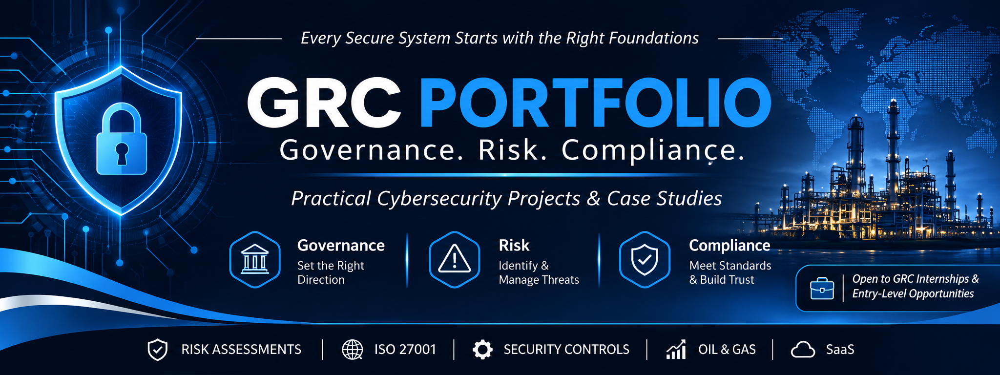

# Cybersecurity GRC Portfolio

Welcome to my practical Governance, Risk, and
Compliance portfolio.

This repository documents cybersecurity GRC
case studies, risk assessments, security control
evaluations, and compliance-focused projects.

The projects explore realistic organizational
scenarios across the oil and gas and SaaS sectors.

## Areas of Focus

- Cybersecurity Risk Management
- ISO/IEC 27001
- NIST Cybersecurity Framework
- Security Governance
- Security Controls
- Third-Party Risk Management
- Incident Response

## Projects

### 1. Oil and Gas Cybersecurity

| Project | Description | Status |
|---|---|---|
| Phishing Risk Assessment | Assessment of phishing threats and organizational exposure in a hypothetical oil and gas company. | Completed |
| ISO 27001 Gap Assessment | Evaluation of information security practices against ISO 27001 requirements. | In Progress |
| Third-Party Risk Assessment | Evaluation of cybersecurity risks associated with external vendors. | Planned |
| Cyber Risk Register | Identification, analysis, and prioritization of organizational cyber risks. | Planned |

### 2. SaaS Security and Compliance

| Project | Description | Status |
|---|---|---|
| SaaS Vendor Risk Assessment | Evaluation of third-party security and compliance risks. | Planned |
| Security Controls Review | Review of organizational security controls. | Planned |

## Frameworks & Standards

- ISO/IEC 27001
- NIST Cybersecurity Framework (CSF)
- Risk Management Principles

## Project Documentation

Each completed project will include:

- Business scenario and scope
- Objectives
- Assets and processes identified
- Threats and vulnerabilities
- Risk analysis
- Recommended security controls
- Findings and recommendations

## Important Notice

All organizational names, scenarios, and
business information used in hypothetical
case studies are fictional and created
for educational and portfolio purposes.

## Contact

LinkedIn: https://www.linkedin.com/in/sonia-achu
